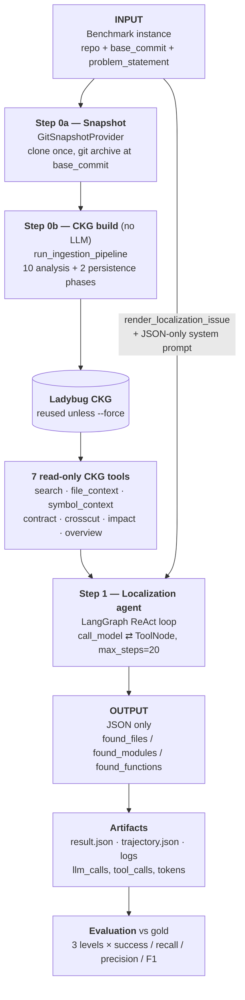
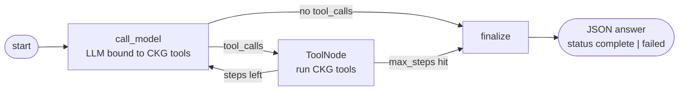
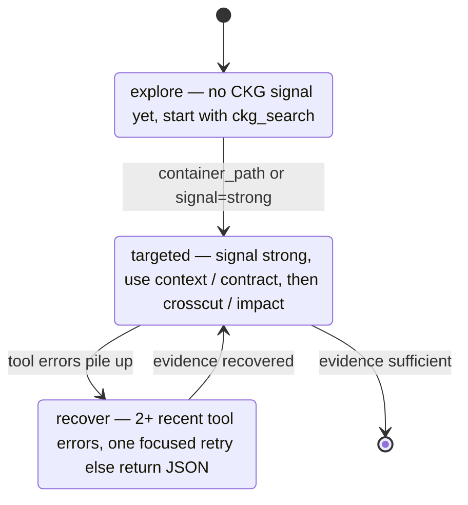

# Jacc-v2 — Agent Workflow (current design)

Entrypoint `src/run_localize.py`; evaluation `src/evaluate_localize.py`.

## 1. End-to-end flow

## 2. Step 1 in detail — the agent loop

Each `call_model` turn re-detects a phase and injects it as a `SystemMessage`
(`_detect_phase`, active only when `AgentConfig.enable_ckg_phase_policy=True`,
which `run_localize.py` sets):

## 3. Notes

- Single-agent ReAct loop; no separate search/causal agents. The differentiator
  is the offline CKG build plus the phase policy steering tool choice.
- The agent is strictly read-only: no shell, no edits, no patch generation.
- All CKG results are path-normalized to repo-relative plus a `/testbed`
  container path before reaching the model.
